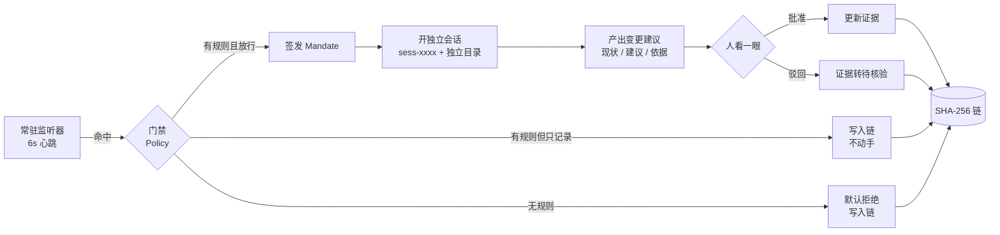

<div align="center">

# MTO Agent

**一个为「可信」而生的机器人。**

它不写更多内容，它守住你说过的每一句话还能不能算数。

[](./LICENSE)
[](https://github.com/deepseek-ai/dsh-superagent-prototype)
[](#-可信链-为什么日志不能自己写自己)
[](./mto.html)

[看效果](#-三十秒看效果) · [它解决什么](#-它解决的不是没有证据是证据没人养) · [可信链](#-可信链-为什么日志不能自己写自己) · [部署](#-部署) · [边界](#-它不做什么)

</div>

---

> 一个做 Agent 的团队，用 Agent 写 Agent，然后原样开源，还主动说清边界。
> **在一个所有人都在喊「颠覆」的行业里，主动说清边界的人，反而更容易被信。**
>
> 这句话对做 MTO 的人同样成立：你要让机器敢信你，靠的不是说得更响，是**说得更准、更可查、边界更清楚**。

---

## 🎯 三十秒看效果

```bash
git clone <this-repo> && cd mto-agent
open mto.html        # 双击也行，没有依赖，没有后端，没有 API Key
```

打开后你会看到一块**空的面板**。这不是没做好——这是设计。

因为面板只显示「需要你动手的事」。健康状态不占你的注意力。

等十秒，监听器心跳命中一条快过期的资质证据，你会看到：

1. 一张工单冒出来：现状、建议、依据、置信度
2. 一张 **Mandate**：谁发起、依据哪条规则、策略版本、作用域、签发时间
3. 一个已开好的**独立会话** `sess-xxxx` 和它的目录
4. 你只做一个动作：**批准**或**驳回**
5. 无论哪种，都写入一条**不可篡改**的链

点「模拟篡改」，改第 6 块，再点「校验全链」：

```
校验失败：第 6 块 —— 块哈希与内容不符（第 6 块内容被改写）
```

这就是全部。剩下的都是细节。

---

## 🧭 它解决的不是「没有证据」，是「证据没人养」

一个中等规模的品牌，可核验的原子事实有多少条？

| 类型 | 数量 | 特点 |
| --- | --- | --- |
| 产品参数 | 几十到几百 | 随版本变 |
| 价格与政策 | 几十 | 对外承诺，改一次就是一次承诺 |
| 资质与认证 | 十几 | **每条都有有效期** |
| 客户案例 | 几十 | **每条都要授权续期** |
| 服务承诺 | 几十 | 法律与合规风险最高 |
| 第三方平台表述 | 几百 | **随时会变，且不受你控制** |

保守估计：**500 到 2000 条。**

每一条都有自己的生命周期。**这意味着你做完第一版的那一刻，它已经开始过期了。**

### 为什么人做不到

假设每季度核一次，2000 条就是 2000 次核验，按每条 10 分钟算：

> **333 个工时 / 季度，专门用来核对「我们说过的话还算不算数」。**

没有公司会批这个预算。所以现实是：**做完就不管了，直到出事。**

### 为什么 Agent 能做到

不是因为 Agent 更聪明，是因为 **Agent 不累**。

人做 2000 次重复核验，第 500 次就开始出错。Agent 做第 500 次和第 1 次一样。

> 而 333 个工时，可以压缩成「每周看一眼队列」。

**这就是 MTO 缺的那台发动机。**

---

## 🏗 它怎么运作



三个关键设计，都不是我发明的，是从 dsh-superagent 的设计里拿的：

| 设计 | 它解决的问题 | 本项目的落法 |
| --- | --- | --- |
| **事件驱动，不巡检** | 定期巡检的成本比事件驱动高一个量级 | 6 秒心跳，只在台账真有对应问题时产生事件 |
| **不可变 Mandate** | 证据被悄悄改了，没人知道谁改的、依据什么改的 | 每张工单附凭证：规则、策略版本、强度、作用域、发起人、签发时间 |
| **隔离会话** | 处理第十件事时被前九件的上下文带偏 | 每张工单独立 `sess-xxx` 与独立目录 |

### 门禁：授权边界是安全边界

默认六条规则，可直接改：

| 规则 | 作用域 | 事件 | 裁决 | 强度 |
| --- | --- | --- | --- | --- |
| R1 | 资质认证 | 到期 | 自动开工单 | 高 |
| R2 | 价格政策 | 任意 | 自动开工单 | 高 |
| R3 | 产品参数 | 引用源变更 | 自动开工单 | 中 |
| R4 | 第三方表述 | 漂移 | 自动开工单 | 低 |
| R5 | 客户案例 | 到期 | 自动开工单 | 中 |
| R6 | 全部 | 竞品变更 | **仅记录** | 低 |

关键在最后一行和「没有匹配规则」：

> **没有规则覆盖的事件，默认拒绝，不是默认放行。**

一个能替整个团队行动的 Agent，也能替整个团队犯错。「看起来合理所以自动执行」在营销场景里特别危险——它可能是一次未经审批的对外承诺变更。

**效率问题可以事后优化，安全问题不行。**

---

## 🔐 可信链：为什么日志不能自己写自己

假设你的 Agent 维护证据链，同时它自己生成审计日志。

那么问题来了：

> **这份日志的可信度，等于这个 Agent 的可信度。**

如果 Agent 出错了、被提示词注入了、或者日志被事后改过——**你手上什么都没有。**

所以本项目的做法是：

**Agent 负责执行和记录，但记录的完整性靠外部机制保证。**

每条记录算 SHA-256，哈希把前一块串进来：

```js
hash = SHA256({ seq, ts, type, payload, prev })
```

改任何一块，后面全部对不上。校验会告诉你**具体是第几块**被改了。

「锚定」把根哈希记下来。之后任何改动都会显示：

> 链已偏离锚点：锚点记录根 `a1b2…`（高度 41），当前根 `c3d4…`（高度 43）

> **Agent 让证据链可以被维护，但只有不可篡改，让证据链值得被相信。**
> 缺前者，你养不起；缺后者，养了也不算数。

---

## 📦 仓库结构

```
mto-agent/
├── mto.html                   # 完整机器人：单文件，零依赖，双击即跑
├── DEPLOY.md                  # 部署指南：演示、运行时、三个坑、凭证清单
├── runtime/                   # Agent 运行时内核（dsh-superagent 全量源码，MIT）
│   ├── src/                   # 门禁、Mandate、Ticket、Session、Source 实现
│   ├── docs/                  # 000 哲学 ～ 008 Cookbook，按序阅读
│   ├── prompts/               # 主 Session 与 Worker 的提示词分层
│   ├── skills/                # GitHub / 飞书来源技能
│   ├── tests/                 # 1197 个用例
│   └── scripts/               # 启停、状态、健康检查
├── README.md                  # 你正在读的这份
└── LICENSE                    # MIT
```

**为什么把 runtime 一并放进仓库**：概念要能落地才有说服力。`mto.html` 证明「这套结构能跑通」，`runtime/` 是它对应的真实执行内核——门禁在哪、Mandate 怎么签发、会话怎么隔离，都能直接读代码核对。`node_modules` 与 `lib` 已剔除，`pnpm install && pnpm build` 即可恢复。

`mto.html` 内部分六页：

| 页面 | 作用 |
| --- | --- |
| **需要人** | 只列在等你的东西，健康状态不占位置 |
| **证据台账** | 24 条种子原子事实，类型 / 引用源 / 有效期 / 状态 |
| **监听器** | 事件流 + 手动注入，验证门禁取值 |
| **门禁规则** | 改裁决会生成新策略版本，已签发的 Mandate 不追溯 |
| **可信链** | 区块浏览、全链校验、模拟篡改、锚定根哈希 |
| **审计** | 导出完整审计包（JSON，可离线复核） |

---

## 🚀 部署

### 只想看演示

打开 `mto.html`。就这样。

### 想接真实的 Agent 运行时

`runtime/` 已在本仓库里，不用另外 clone。`DEPLOY.md` 有完整流程，摘要：

```bash
npm install -g @deepseek-ai/dsh@0.2.1-rc.3   # 必须 Node 22.19+ 或 24+
cd runtime
pnpm install && pnpm i -D unrun && pnpm build
dsh superagent --from-default-profile web --dump-config > /dev/null
dsh plugin --profile superagent add "link:$PWD"
```

三个坑，先记住：

1. `host` **不能**写 `0.0.0.0`。webserver 会拒绝——绑定所有网卡等于把远程代码执行暴露到网络。写具体 IP。
2. `pnpm build` 会报 `Failed to import module "unrun"`，**是缺可选依赖**，不是代码坏了。
3. `--from-default-profile` 只能用一次。profile 已存在时再跑会覆盖你的机器配置。

跑起来之后需要四样凭证：模型 API Key、Agent 的 GitHub 账号、该账号的 gh CLI 登录、目标仓库与允许名单。缺一样，runtime 就停在 `paused`——面板能开，Agent 不动手。

---

## 🚧 它不做什么

这一节比上面任何一节都重要。

| 不做 | 为什么 |
| --- | --- |
| 不自动发布对外承诺 | 价格、价格条款、资质口径的变更必须人批。门禁里写死了 |
| 不篡改第三方平台 | 第三方表述漂移只提交修正建议，不代替你去改别人的平台 |
| 不制造「一切正常」的报告 | 健康状态不占面板空间。这是设计，不是缺功能 |
| 不假装日志可信 | 浏览器 localStorage 可被清空。所以根哈希**必须**锚到外部，锚点机制只是给你这个动作 |
| 不保证记录是对的 | 链只保证「记录没被改」。核验正确性仍然靠人 |

关于最后两条，有一个必须说清的事实：

> **本仓库的 mto.html 是协议的可运行演示，不是生产系统。**
>
> 它证明的是「这套结构能跑通、能被校验」。把它当生产用之前，你需要把链的存储从 localStorage 换成服务端，把锚点接到真实的时间戳服务或公开账本，把门禁接到真实的审批流。

### 关于上游

本项目的概念结构来自 [dsh-superagent-prototype](https://github.com/deepseek-ai/dsh-superagent-prototype)（MIT）。它自己就声明了三件事，转述时请一并保留：

1. 研究原型，不是 DeepSeek 官方产品，未做安全审计。
2. 只有一个 commit，整理后一次性开源，不是长期迭代项目。
3. 配套设计文章里的部分设计**没有在原型里实现**。读架构图别当产品说明书。

还有一条更实际的：上游两个 preset 都以 `danger-full-access` 运行，Worker 能按路径执行程序、能读 home 目录。官方建议用独立操作系统账号隔离。

---

## 💭 一个判断，留给同行

如果所有品牌都用 Agent 自动优化内容，**内容供给会爆炸**。

被提到，会变得廉价。

到那时候，**「被提到」和「被采信」会彻底分家**——而分家的那条线，就是可验证性。

所以别误会：

> Agent 化不是让 MTO 变得不重要，是让 MTO 从「加分项」变成「唯一的区分项」。

---

<div align="center">

**最后剩下的，只有那些能被查证的。**

<sub>MIT License · 概念结构致敬 DeepSeek Harness Team</sub>

</div>
